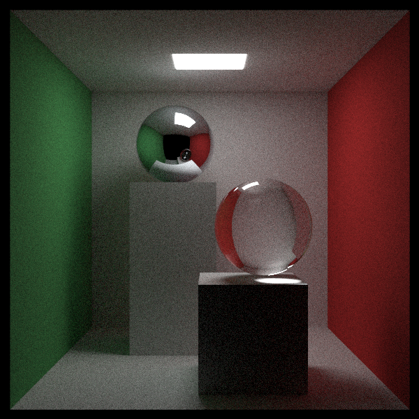
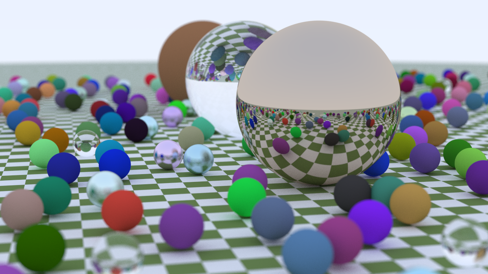
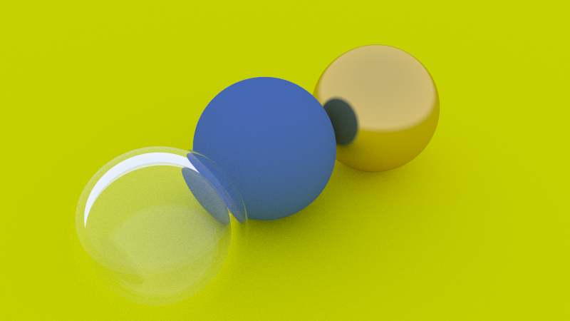

# Monte Carlo Path Tracer

A Path Tracer program I wrote in C++ with no external library. Based on Peter Shirley's Ray Tracing book series

*A classic computer graphics test scene*

## Features

- Simulates light bouncing, reflecting, and refracting through a scene,
  pixel by pixel, to build up a realistic image
- Three materials: matte, mirror-like metal, and glass
- Camera lens blur (depth of field), like a real camera
- Multiple scenes: a field of hundreds of objects, a simple test scene, and
  the Cornell box above
- Own image file writer — no external libraries used anywhere
- Uses all CPU cores to render faster

*485 objects in one scene, with lens blur on the background spheres.*

## Performance improvements 

- Added a tree structure so rays skip distant objects: 74.6s → 5.9s (12x)
- Smarter sampling + early exit for low-impact rays: 32.4s → 14.5s (2x)

## Numbers

1,217 lines of C++ code, split across 13 files.

*The simplest test scene, rendered in under a second.*

## Technical details

**Rendering algorithm**
- Monte Carlo path tracer  — full global illumination, indirect bounces, color bleeding
- Stratified jittered sampling per pixel (samples laid on a sqrt(n) grid) — cuts noise vs naive sampling
- Russian-roulette path termination after 3 bounces — unbiased, skips low-contribution bounces
- Gamma correction (√ approximation of γ=2.2) on output

**Geometry**
- Spheres, with UV mapping 
- Quads (parallelograms) — used to build axis-aligned boxes (6 quads each)
- BVH (bounding volume hierarchy) acceleration structure, built once per render, split on longest axis — makes 400+ object scenes fast instead of O(n) per ray

**Materials**
- Lambertian (matte diffuse)
- Metal, with adjustable fuzz/roughness
- Dielectric (glass) — real Snell refraction + Schlick Fresnel approximation + total internal reflection
- Diffuse light (emissive, for the Cornell box's ceiling panel)
- Textures: solid color and a checkerboard pattern

**Camera**
- Positionable (lookfrom/lookat/vup), adjustable vertical FOV
- Thin-lens depth-of-field (aperture + focus distance)

**Performance**
- Multithreaded — scanlines pulled off an atomic counter, auto-detects core count or set via `--threads`
- Deterministic regardless of thread count (verified: identical SHA-256 output at 1 vs 13 threads) — each row seeds its own RNG from the row index
